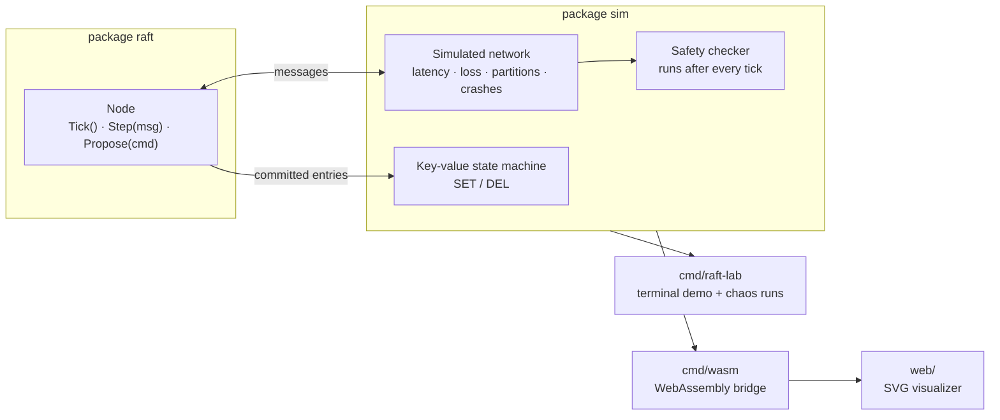
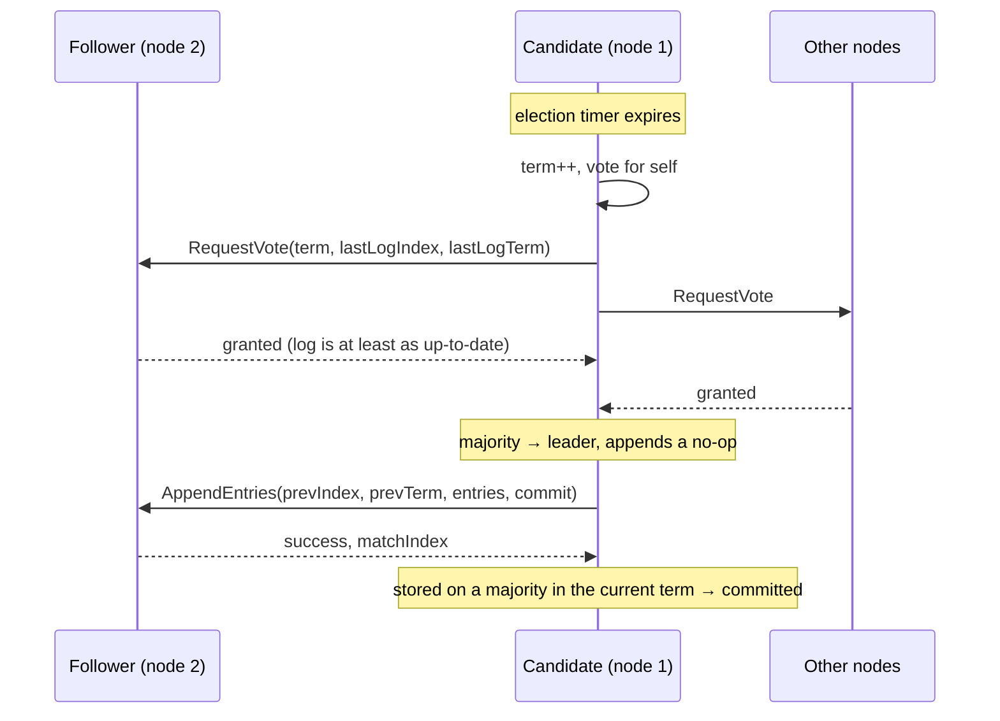

# 🗳 raft-lab

[](https://github.com/ardazeybek-dev/raft-lab/actions/workflows/ci.yml)
[](https://pkg.go.dev/github.com/ardazeybek-dev/raft-lab)
[](https://ardazeybek-dev.github.io/raft-lab/)

The [Raft consensus algorithm](https://raft.github.io/raft.pdf) written from scratch in Go: leader election
and log replication, a simulated network that loses, delays and reorders messages, and a checker that
watches every tick for safety violations. The same code runs in unit tests, in a terminal simulator and
in the browser, compiled to WebAssembly.

**▶ [Open the live demo](https://ardazeybek-dev.github.io/raft-lab/)** — crash the leader, split the
network, turn up packet loss, and watch the cluster keep every committed write.

Raft is what keeps etcd (Kubernetes), Consul, CockroachDB and Kafka's KRaft controller consistent when
machines fail. This project exists to understand it by building it and then trying hard to break it.

## 🛠 Tech Stack

| Layer          | Technology                                              |
|----------------|---------------------------------------------------------|
| Language       | Go 1.24+ (standard library only, no dependencies)       |
| Browser        | WebAssembly (`GOOS=js GOARCH=wasm`), vanilla JS, SVG    |
| Testing        | `go test`, randomized fault injection, mutation checks  |
| CI / hosting   | GitHub Actions, GitHub Pages, GitHub Releases           |

## 🏗 Architecture



A `raft.Node` never reads a clock, starts a goroutine or opens a socket. The caller tells it that time
passed (`Tick`) or that a message arrived (`Step`), and collects the messages it wants to send. This is
the design etcd's Raft library uses, and it buys three things:

- **Deterministic runs.** Every random choice comes from a seed, so a failing run replays exactly.
- **Fast tests.** 200 clusters × 3,000 ticks of chaos finish in about a second.
- **It runs anywhere.** No goroutines or timers to port, so the browser build is the same code.



## 🚀 Running it

```bash
# Browser: https://ardazeybek-dev.github.io/raft-lab/ or build it locally
GOOS=js GOARCH=wasm go build -o web/raft.wasm ./cmd/wasm
cp "$(go env GOROOT)/lib/wasm/wasm_exec.js" web/
python -m http.server -d web 8000   # open http://localhost:8000

# Terminal: guided demo (election → writes → leader crash → partition → heal)
go run ./cmd/raft-lab

# Chaos: 500 random clusters with crashes, partitions and 20% message loss
go run ./cmd/raft-lab -chaos -seeds 500 -drop 0.2
# 500/500 seeds safe (5 nodes, 5000 ticks each, 20% message loss)

# Or install the binary
go install github.com/ardazeybek-dev/raft-lab/cmd/raft-lab@latest
```

Prebuilt binaries for Linux, macOS and Windows are on the
[releases page](https://github.com/ardazeybek-dev/raft-lab/releases).

Excerpt from the terminal demo:

```text
▶ Network splits: node 4 is cut off, the majority keeps going
  t=281   network partitioned: [1 2 3 5]
  t=298   node 1 timed out, starts election for term 5
  t=304   node 1 is leader for term 5
  t=304   client → node 1: "SET partition survived" (index 7)
  t=312   index 7 committed: "SET partition survived"

▶ Network heals: the stale leader steps down and its uncommitted write is discarded
  t=364   network healed
  t=371   node 4 steps down: it saw term 5, newer than its own
```

## 🧪 Tests

```bash
go test ./...
```

| Test | What it proves |
|------|----------------|
| `TestElectsExactlyOneLeader` | a healthy cluster converges on one leader everyone agrees on |
| `TestReplicatesAndCommits` | writes reach every node and commit in order |
| `TestLeaderCrashTriggersNewElection` | a new leader takes over in a higher term, committed data survives |
| `TestMinorityPartitionCannotCommit` | a leader cut off with a minority accepts writes but never commits them |
| `TestRestartedNodeCatchesUp` | a node that missed 20 writes is repaired by the leader after restart |
| `TestFigure8` | replays Figure 8 of the Raft paper step by step (see below) |
| `TestVoteRequiresUpToDateLog`, `TestOneVotePerTerm` | the two voting rules behind Election Safety |
| `TestConflictingSuffixIsTruncated`, `TestStaleAppendDoesNotTruncate` | log repair, and that a late duplicate message can't erase entries |
| `TestChaos` | 200 seeds × 3,000 ticks of random crashes, restarts, partitions and 20% loss: no violations, and the cluster commits again once faults stop |

**The checker is only as good as the bugs it catches**, so the tests were run against deliberately broken
versions of the algorithm:

| Mutation | Caught by |
|----------|-----------|
| Grant votes without checking the candidate's log is up to date | `TestChaos` — different entries committed at the same index |
| Commit old-term entries by counting replicas (the Figure 8 bug) | `TestFigure8` — random chaos alone did **not** catch this one |

### Figure 8, the subtle one

A leader may only mark an entry committed by counting replicas if the entry is from its **own** term.
Otherwise this can happen:

1. S1 leads term 1 and replicates entry `x` to S2 only.
2. S1 crashes. S5 wins term 2 with votes from S3, S4 and appends `y` locally.
3. S5 crashes, S1 wins term 3 and copies `x` to S3. `x` is now on a majority — tempting to call it committed.
4. S1 crashes. S5's last term (2) beats everyone else's (1), so it wins again and overwrites `x` everywhere.

If step 3 had committed `x`, a committed entry would have been lost. `TestFigure8` drives five nodes
through exactly this sequence with a hand-controlled network. The fix is the rule above, plus a no-op
entry that every new leader appends so older entries get committed indirectly.

## 📁 Project Structure

```
raft-lab/
├── raft/               # the algorithm: one Node, no I/O, no goroutines
│   ├── raft.go
│   └── raft_test.go    # voting rules, log repair, Figure 8
├── sim/                # cluster + unreliable network + safety checker
│   ├── sim.go
│   ├── snapshot.go     # JSON view for the browser, key-value state machine
│   └── sim_test.go     # scenarios and chaos tests
├── cmd/
│   ├── raft-lab/       # terminal simulator
│   └── wasm/           # WebAssembly bridge (syscall/js)
├── web/                # index.html, style.css, app.js
└── .github/workflows/  # CI, GitHub Pages deploy, release binaries
```

## 📚 Concepts in this project

- **Term** — a logical clock. Seeing a higher term makes any node step down to follower on the spot.
- **Randomized election timeouts** — so two nodes rarely start an election at the same moment; when they
  do (a split vote), both time out again at different times.
- **Election Safety** — one vote per term, and only for a candidate whose log is at least as up to date,
  so a term never has two leaders and a leader always holds every committed entry.
- **Log Matching** — `AppendEntries` carries the index and term of the entry before the new ones; a
  follower that disagrees rejects it, and the leader walks back until the logs match.
- **Commit rule** — an entry is committed once a majority stores it *and* it is from the leader's current
  term. Committed entries are then applied to a key-value store.
- **Partitions** — the minority side can't elect a leader or commit. Its stale leader steps down when the
  network heals and its uncommitted entries are overwritten.
- **Deterministic simulation testing** — the approach FoundationDB and TigerBeetle use: run the real code
  against a simulated, hostile world where every failure can be replayed from a seed.

## ⚖️ Known limitations

Deliberately left out to keep the core readable:

- No log compaction / snapshots — the log grows forever.
- No cluster membership changes — the node set is fixed.
- No PreVote — a node that was cut off comes back with a higher term and forces a fresh election.
- Persistence is simulated: a restart keeps term, vote and log in memory instead of writing to disk.
- Reads are not linearizable; the UI shows what each node has committed.

## ⚠️ Pitfalls

- Chaos runs stop electing leaders → message latency is close to the election timeout → keep the round trip well below the minimum timeout (Raft's `broadcastTime ≪ electionTimeout`).
- Browser shows `Cannot read properties of null` → Go encodes empty slices as `null` in JSON → initialize slices before marshalling anything sent to JavaScript.
- `wasm_exec.js` must match the Go version that built `raft.wasm` → always copy it from `$(go env GOROOT)/lib/wasm/`, never from an old checkout.

## License

MIT
